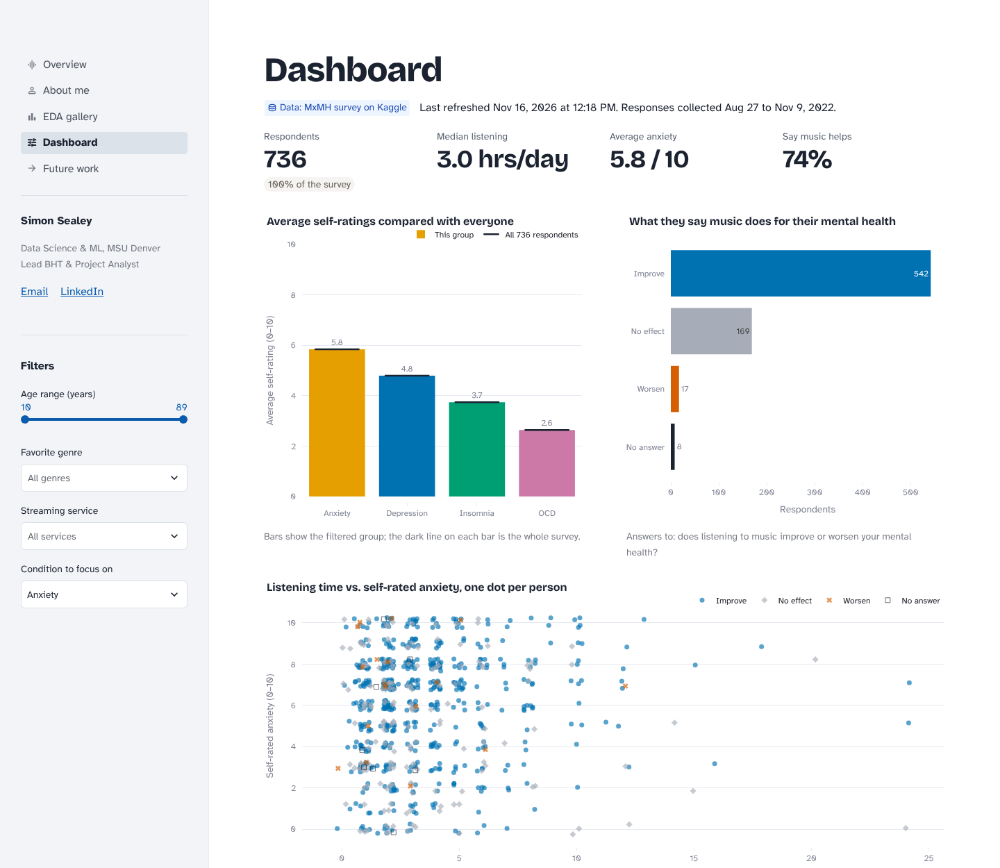
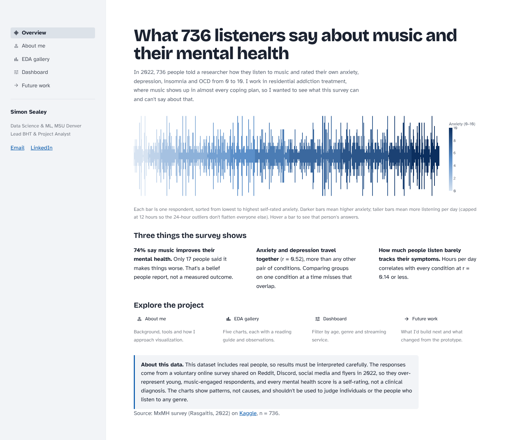

# 🎧 Music & Mental Health: A Streamlit Portfolio App

A multi-page Streamlit app that serves as my data visualization portfolio and a small analytics product. It explores the Music & Mental Health (MxMH) survey to see how people's listening habits line up with their self-rated anxiety, depression, insomnia and OCD, using an EDA gallery and an interactive dashboard.

**Live app:** [https://mxmh-app-portfolio.streamlit.app](https://mxmh-app-portfolio.streamlit.app)  <!-- TODO: paste your Streamlit Cloud URL -->

## Author

**Simon Sealey**, B.S. Data Science & Machine Learning (minor in Social Work), MSU Denver
- Email: ssealey2@msudenver.edu or simon.sealey.ss@gmail.com
- LinkedIn: www.linkedin.com/in/simon-sealey-008317199 <!-- TODO -->

## App navigation

| Page | Contents |
|---|---|
| **Overview** | A waveform of all 736 respondents, three headline findings, ethics note |
| **About me** | Professional summary, highlights, visualization philosophy, contact |
| **EDA gallery** | Five chart types (histogram, box plot, correlation heatmap, 100% stacked bar, line chart). Each has a guiding question, a "How to read this chart" guide and observations. Four are interactive (condition/genre selectors, hover, zoom, legend toggles) |
| **Dashboard** | Sidebar filters (age range, favorite genre, streaming service, focus condition) that drive 4 KPIs and 3 linked charts, plus insight bullets, a data source badge and a "last refreshed" line |
| **Future work** | Five next steps and a reflection on changes since the Lab 4.3 paper prototype |

## Dataset

- **Name:** Music & Mental Health Survey Results (MxMH), by Catherine Rasgaitis
- **Source:** https://www.kaggle.com/datasets/catherinerasgaitis/mxmh-survey-results
- **Records:** 736 survey responses × 33 columns, collected Aug 27 – Nov 9, 2022
- **Contents:** age, primary streaming service, listening hours per day, favorite genre, listening frequency for 16 genres, BPM of favorite genre, self-rated anxiety/depression/insomnia/OCD (0–10), and whether music improves or worsens the respondent's mental health

### Preprocessing (in `utils.load_data`, cached with `@st.cache_data`)
- Dropped `Permissions` (all 736 rows have the same consent value).
- Parsed `Timestamp` to datetime.
- Set implausible `BPM` values (below 40 or above 250, e.g. 0 and 999,999,999) to missing: 8 values on top of 107 already blank. No rows were removed.
- Renamed "I do not use a streaming service." to "No streaming service" and filled the one blank service as "Not reported."
- Added an `Age group` column (10–17, 18–24, 25–34, 35–49, 50+). One respondent has no age; they're kept in totals and dropped only from age-based charts.
- Made the genre-frequency columns ordered categories (Never → Very frequently).
- Left the 8 blank `Music effects` answers as missing; they're excluded from percentages and shown as "No answer" in dashboard counts.
- The box plot shows only genres with 20+ fans (Lofi, Gospel and Latin are excluded and named in the caption).

### Ethics note
This dataset includes real people, so results must be interpreted carefully. The responses come from a voluntary online survey shared on Reddit, Discord, social media and flyers, so they over-represent young (median age 21), music-engaged respondents, and every mental health score is a self-rating rather than a clinical diagnosis. The visualizations show patterns, not causes, and should not be used to make judgments about individuals or about the people who listen to any genre.

## Run locally

```bash
git clone https://github.com/YOUR-USERNAME/YOUR-REPO.git
cd YOUR-REPO
pip install -r requirements.txt
streamlit run app.py
```

On Streamlit Community Cloud, set the main file path to `app.py`.

## Requirements
See [`requirements.txt`](requirements.txt): streamlit 1.67.0, pandas 3.0.5, numpy 2.5.3, plotly 7.1.0 (Python 3.11+).

## Project structure
```
├─ app.py                     # Entry point: page config, styling, st.navigation
├─ utils.py                   # Cached data loading + cleaning, Plotly theme, layout helpers
├─ pages/
│  ├─ home.py                 # Overview
│  ├─ bio.py                  # About me
│  ├─ gallery.py              # EDA gallery
│  ├─ dashboard.py
│  └─ future_work.py
├─ data/mxmh_survey_results.csv
├─ assets/                    # Banner image and README screenshots
├─ static/fonts/              # Bundled fonts (SIL Open Font License)
├─ .streamlit/config.toml     # Theme: colors, fonts, static serving
├─ requirements.txt
└─ README.md
```

## Accessibility
- Body text is set in Atkinson Hyperlegible, a typeface designed by the Braille Institute for low-vision readers; headings use Bricolage Grotesque. Both are bundled in `static/fonts`.
- Okabe-Ito color-blind-safe palette throughout; the heatmap uses a purple–orange diverging scale with values printed in each cell.
- Line and scatter charts also use different marker shapes, so color isn't the only cue.
- Fixed 0–10 axes on all score charts to avoid exaggerating small differences; units on every axis.
- Alt text on the Bio image.

## Screenshots




## AI assistance
I used Claude (Anthropic) to help scaffold the app code, draft chart explanations and edit this README; I reviewed, tested and revised all of it.
